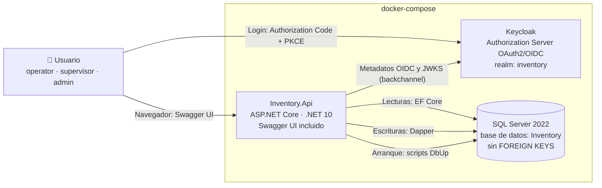
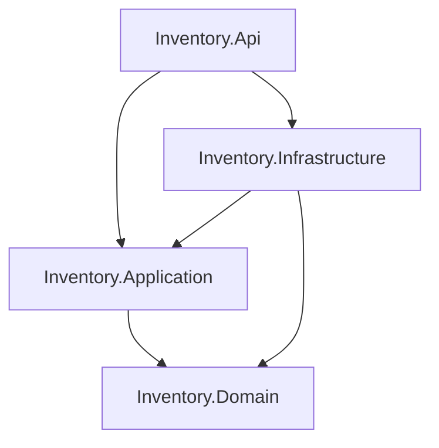

# ARCH_SKELETON — Esqueleto Arquitectónico

> **Capa 0 SDAP · Inmutable.** Ningún agente puede contradecir este documento. Un cambio exige un ADR nuevo en `docs/adr/` y la actualización explícita de este archivo por el humano.
> Decisiones de origen: ADR-0001, ADR-0002, ADR-0003, ADR-0004, ADR-0014.

---

## 1. Descripción del sistema

API REST de gestión de inventario para un **almacén de gran superficie** (un solo almacén) organizado en **Áreas → Categorías → Productos**. Permite administrar el catálogo y registrar movimientos de inventario (entradas, salidas y ajustes) en un **libro inmutable**, con el stock materializado en el producto. Seguridad delegada a un servidor OAuth2 externo (Keycloak) con autorización por rol, scope y área.

**Fuera de alcance:** multi-sede, precios y ventas, interfaz de usuario propia (el único cliente visual es Swagger UI).

---

## 2. Patrón arquitectónico

- **Clean Architecture** en 4 proyectos. Las dependencias apuntan siempre hacia el dominio.
- **CQRS** con la librería **Mediator** (MIT, generada en compilación):
  - **Queries** (lado lectura): **EF Core**, `AsNoTracking()` y proyección directa a DTO. EF **nunca** escribe.
  - **Commands** (lado escritura): **Dapper**. Incluye la lectura del estado necesario para decidir la escritura, dentro de la misma transacción.
- **Validación** de entrada mediante *pipeline behavior* + FluentValidation.
- **Doble barrera de reglas:** el dominio valida y produce errores comprensibles; la sentencia SQL atómica garantiza la regla ante concurrencia (ver `INTERFACE_FLOW.md`).

---

## 3. Diagrama de contenedores (C4 — nivel 2)



---

## 4. Proyectos y regla de dependencias



| Proyecto | Responsabilidad | Puede depender de | Prohibido |
|---|---|---|---|
| `Inventory.Domain` | Entidades, enums, reglas e invariantes, excepciones de dominio | Nada | Cualquier paquete NuGet o referencia a otro proyecto |
| `Inventory.Application` | Commands, Queries, handlers, validadores, DTOs, puertos (interfaces), mensajes de error | `Domain`, Mediator, FluentValidation | EF Core, Dapper, ASP.NET Core |
| `Inventory.Infrastructure` | Implementación de puertos: lectura EF, escritura Dapper, DbUp, scripts SQL | `Application`, `Domain` | Lógica de negocio |
| `Inventory.Api` | Controllers, autenticación, políticas, ProblemDetails, Swagger, composición (DI) | `Application`, `Infrastructure` | Lógica de negocio, SQL |

**Puertos principales (definidos en `Application`, implementados en `Infrastructure`/`Api`):**
- `I*ReadRepository`: lecturas con EF que devuelven DTOs.
- `I*WriteRepository` + `IUnitOfWork`: escrituras Dapper con transacción.
- `ICurrentUser` (implementado en `Api` a partir de las claims): `Subject`, `Roles`, `AreaCodes`.
- `IClock`: hora UTC, para tests deterministas.

**Proyectos de prueba:**

| Proyecto | Cubre |
|---|---|
| `tests/Inventory.Domain.Tests` | Reglas e invariantes |
| `tests/Inventory.Application.Tests` | Handlers, validadores, autorización por área |
| `tests/Inventory.Api.Tests` | Mapeo de excepciones a ProblemDetails, lectura de claims |
| `tests/Inventory.IntegrationTests` | *(Extra)* SQL real con Testcontainers |

---

## 5. Estructura de carpetas

```
/
├── .sdap/                      # Capa 0 (este directorio)
├── docs/adr/                   # Decisiones
├── docs/ai/                    # Capa 1 (contexto vivo)
├── keycloak/realm-inventory.json
├── src/
│   ├── Inventory.Domain/        {Areas, Categories, Products, Movements, Common}
│   ├── Inventory.Application/   {Areas, Categories, Products, Movements}/{Commands, Queries}
│   │                            Common/{Behaviors, Interfaces, Exceptions, Pagination, Messages}
│   ├── Inventory.Infrastructure/ Persistence/{Read, Write}, Migrations/Scripts
│   └── Inventory.Api/           {Controllers, Authorization, ErrorHandling, Configuration}
├── tests/
├── docker-compose.yml
├── .env.example
└── AGENTS.md
```

---

## 6. Tech Fence (valla tecnológica)

**Solo se permite lo listado.** Añadir cualquier otra dependencia requiere un ADR. Las versiones exactas se fijan en `docs/ai/01-tech-stack.md`.

| Ámbito | Tecnología | Restricción |
|---|---|---|
| Runtime | .NET 10 (`net10.0`) | `<LangVersion>12</LangVersion>`: el compilador impide usar C# 13/14 y garantiza poder bajar a .NET 8 (ADR-0001) |
| Web | ASP.NET Core Controllers | Sin Minimal APIs |
| Mediator / CQRS | `Mediator.SourceGenerator` + `Mediator.Abstractions` (MIT) | **Prohibido MediatR ≥ 13** (licencia comercial) |
| Validación | FluentValidation | Solo en `Application` |
| Lectura | `Microsoft.EntityFrameworkCore.SqlServer` 10.x | Solo en `Infrastructure/Persistence/Read`. Prohibido `SaveChanges` |
| Escritura | Dapper 2.x + `Microsoft.Data.SqlClient` | Solo en `Infrastructure/Persistence/Write` |
| Esquema | DbUp (`dbup-sqlserver`) | Scripts SQL versionados `NNNN_descripcion.sql`, nunca se editan una vez commiteados |
| Autenticación | `Microsoft.AspNetCore.Authentication.JwtBearer` | Validación de JWT de Keycloak |
| Documentación | `Swashbuckle.AspNetCore` | OAuth2 Authorization Code + PKCE en Swagger UI |
| Pruebas | xUnit, NSubstitute, Shouldly, coverlet | **Prohibidos Moq y FluentAssertions ≥ 8** |
| Integración *(extra)* | `Testcontainers.MsSql` | Solo en `Inventory.IntegrationTests` |
| Análisis estático | StyleCop.Analyzers | SA1402 (un tipo por archivo) y SA1649 (nombre de archivo = tipo) como error |
| Base de datos | SQL Server 2022 (contenedor) | **Prohibido `FOREIGN KEY`**. Permitidos `UNIQUE` (filtrados) y `CHECK` |
| Identidad | Keycloak 26.x (contenedor, `start-dev`) | Realm importado desde `keycloak/realm-inventory.json` |

**Explícitamente prohibido:** AutoMapper (licencia comercial; el mapeo es manual), MediatR ≥ 13, Moq, FluentAssertions ≥ 8, migraciones de EF Core, escrituras con EF, `FOREIGN KEY`, secretos en `appsettings*.json`.

---

## 7. Configuración (variables de entorno — regla de Clean Code 5)

Toda la configuración se lee de variables de entorno. `appsettings.json` solo contiene valores no sensibles (logging). En el repositorio se publica `.env.example`; `.env` está en `.gitignore`.

| Variable | Uso | Ejemplo (local) |
|---|---|---|
| `INVENTORY_DB_CONNECTION` | Cadena de conexión SQL Server | `Server=sqlserver;Database=Inventory;User Id=sa;Password=...;TrustServerCertificate=True` |
| `AUTH_AUTHORITY` | Issuer **externo** del realm (el que ve el navegador) | `http://localhost:8180/realms/inventory` |
| `AUTH_METADATA_ADDRESS` | Metadatos OIDC por red **interna** de Docker | `http://keycloak:8080/realms/inventory/.well-known/openid-configuration` |
| `AUTH_AUDIENCE` | Audiencia esperada en el token | `inventory-api` |
| `SWAGGER_OAUTH_CLIENT_ID` | Cliente público de Swagger UI | `inventory-swagger` |
| `MSSQL_SA_PASSWORD` | Contraseña SA del contenedor SQL | — |
| `KC_BOOTSTRAP_ADMIN_USERNAME` / `KC_BOOTSTRAP_ADMIN_PASSWORD` | Admin de la consola Keycloak | — |

---

## 8. Despliegue (docker-compose)

| Servicio | Imagen | Puerto host | Healthcheck | Depende de |
|---|---|---|---|---|
| `sqlserver` | `mcr.microsoft.com/mssql/server:2022` | 1433 | Consulta `SELECT 1` | — |
| `keycloak` | `quay.io/keycloak/keycloak:26` | 8180 | Endpoint de salud de Keycloak | — |
| `api` | Build de `src/Inventory.Api/Dockerfile` | 8080 | `GET /health` | `sqlserver` y `keycloak` en estado *healthy* |

Un único comando levanta todo: `docker compose up --build`.

---

## 9. Límites modulares

Cuatro módulos funcionales, cada uno con sus carpetas en `Domain`, `Application` e `Infrastructure`:

| Módulo | Entidad raíz | Depende lógicamente de |
|---|---|---|
| Areas | `Area` | — |
| Categories | `Category` | Areas |
| Products | `Product` | Categories (y Areas para autorización) |
| Movements | `InventoryMovement` | Products |

Un módulo no invoca los handlers de otro módulo. Las comprobaciones entre módulos (por ejemplo, "la categoría existe y está activa") se hacen con consultas propias del repositorio de escritura del módulo que escribe.
