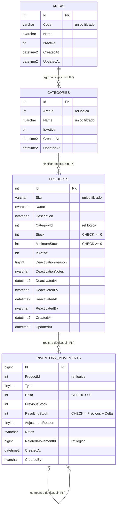

# DATA_MINDMAP — Contratos y Modelos de Datos

> **Capa 0 SDAP · Inmutable.** Ninguna refactorización puede alterar tablas, columnas ni DTOs públicos sin actualizar este documento.
> Decisiones de origen: ADR-0004, ADR-0005, ADR-0008, ADR-0011, ADR-0014.

---

## 1. Diagrama Entidad-Relación

> Todas las relaciones son **lógicas**: no existe ninguna `FOREIGN KEY`. La integridad la garantiza la aplicación (DOMAIN_LOGIC RC-02, RP-03, RM-06).

---

## 2. Esquema físico (SQL Server)

Convenciones: fechas en `DATETIME2(3)` UTC; identificadores `INT IDENTITY`, salvo movimientos (`BIGINT IDENTITY`, porque el libro crece sin límite); `NOT NULL` salvo que se indique.

### 2.1. `Areas`

| Columna | Tipo | Nulo | Notas |
|---|---|:-:|---|
| `Id` | `INT IDENTITY` | | PK |
| `Code` | `VARCHAR(10)` | | |
| `Name` | `NVARCHAR(100)` | | |
| `IsActive` | `BIT` | | Default `1` |
| `CreatedAt` | `DATETIME2(3)` | | |
| `UpdatedAt` | `DATETIME2(3)` | ✔ | |

Índices: `UX_Areas_Code` UNIQUE (`Code`) `WHERE IsActive = 1`.

### 2.2. `Categories`

| Columna | Tipo | Nulo | Notas |
|---|---|:-:|---|
| `Id` | `INT IDENTITY` | | PK |
| `AreaId` | `INT` | | Referencia lógica a `Areas.Id` |
| `Name` | `NVARCHAR(100)` | | |
| `IsActive` | `BIT` | | Default `1` |
| `CreatedAt` | `DATETIME2(3)` | | |
| `UpdatedAt` | `DATETIME2(3)` | ✔ | |

Índices: `UX_Categories_Name` UNIQUE (`Name`) `WHERE IsActive = 1`; `IX_Categories_AreaId_IsActive` (`AreaId`, `IsActive`).

### 2.3. `Products`

| Columna | Tipo | Nulo | Notas |
|---|---|:-:|---|
| `Id` | `INT IDENTITY` | | PK |
| `Sku` | `VARCHAR(50)` | | |
| `Name` | `NVARCHAR(150)` | | |
| `Description` | `NVARCHAR(1000)` | ✔ | |
| `CategoryId` | `INT` | | Referencia lógica a `Categories.Id` |
| `Stock` | `INT` | | Default `0`, `CHECK (Stock >= 0)` |
| `MinimumStock` | `INT` | | Default `0`, `CHECK (MinimumStock >= 0)` |
| `IsActive` | `BIT` | | Default `1` |
| `DeactivationReason` | `TINYINT` | ✔ | `DeactivationReason` |
| `DeactivationNotes` | `NVARCHAR(500)` | ✔ | |
| `DeactivatedAt` | `DATETIME2(3)` | ✔ | |
| `DeactivatedBy` | `NVARCHAR(100)` | ✔ | `sub` del JWT |
| `ReactivatedAt` | `DATETIME2(3)` | ✔ | |
| `ReactivatedBy` | `NVARCHAR(100)` | ✔ | |
| `CreatedAt` | `DATETIME2(3)` | | |
| `UpdatedAt` | `DATETIME2(3)` | ✔ | |

Índices: `UX_Products_Sku` UNIQUE (`Sku`) `WHERE IsActive = 1`; `IX_Products_CategoryId_IsActive` (`CategoryId`, `IsActive`).

### 2.4. `InventoryMovements`

| Columna | Tipo | Nulo | Notas |
|---|---|:-:|---|
| `Id` | `BIGINT IDENTITY` | | PK |
| `ProductId` | `INT` | | Referencia lógica a `Products.Id` |
| `Type` | `TINYINT` | | `MovementType` |
| `Delta` | `INT` | | `CHECK (Delta <> 0)` |
| `PreviousStock` | `INT` | | `CHECK (PreviousStock >= 0)` |
| `ResultingStock` | `INT` | | `CHECK (ResultingStock >= 0)` y `CHECK (ResultingStock = PreviousStock + Delta)` |
| `AdjustmentReason` | `TINYINT` | ✔ | Obligatorio si `Type = 3` (`CHECK`) |
| `Notes` | `NVARCHAR(500)` | ✔ | |
| `RelatedMovementId` | `BIGINT` | ✔ | Referencia lógica a `InventoryMovements.Id` |
| `CreatedAt` | `DATETIME2(3)` | | |
| `CreatedBy` | `NVARCHAR(100)` | | `sub` del JWT |

Índices: `IX_InventoryMovements_ProductId_CreatedAt` (`ProductId`, `CreatedAt DESC`).

> Las restricciones `CHECK` son una **segunda barrera** (defensa en profundidad): el enunciado prohíbe FOREIGN KEYS, no CHECK ni UNIQUE.

### 2.5. `SchemaVersions`
Tabla de control gestionada por DbUp. No se toca manualmente.

### 2.6. Datos semilla (script DbUp)
- Áreas: `FOOD` (Alimentos), `CLEAN` (Aseo), `TOOLS` (Herramientas).
- Al menos dos categorías por área y unos pocos productos de ejemplo con stock 0. El stock inicial se carga con movimientos `In`, para respetar RM-11.

---

## 3. Entidades de dominio (`Inventory.Domain`)

| Entidad | Comportamiento principal (métodos de dominio) |
|---|---|
| `Area` | `Create`, `Rename`, `Deactivate` |
| `Category` | `Create`, `Update`, `Deactivate` |
| `Product` | `Create`, `UpdateDetails`, `ChangeCategory`, `Delete` (exige stock 0), `Deactivate`, `Reactivate`, `IsLowStock` |
| `InventoryMovement` | `CreateInbound`, `CreateOutbound`, `CreateAdjustment` (fábricas que aplican RM-01, RM-02, RM-04, RM-08) |

Una clase o enum por archivo (regla de Clean Code 6). Los métodos reciben objetos, no listas de propiedades (regla 7).

---

## 4. Contratos de transporte (DTOs)

Todos los DTOs son `record` en `Inventory.Application`, uno por archivo. JSON en `camelCase`; enums como texto.

### 4.1. Requests

| DTO | Campos |
|---|---|
| `CreateAreaRequest` | `code`, `name` |
| `UpdateAreaRequest` | `name` |
| `CreateCategoryRequest` | `areaId`, `name` |
| `UpdateCategoryRequest` | `areaId`, `name` |
| `CreateProductRequest` | `sku`, `name`, `description?`, `categoryId`, `minimumStock` |
| `UpdateProductRequest` | `name`, `description?`, `minimumStock` |
| `ChangeProductCategoryRequest` | `categoryId` |
| `DeactivateProductRequest` | `reason`, `notes?` |
| `RegisterMovementRequest` | `type` (`In` \| `Out`), `quantity`, `notes?` |
| `RegisterAdjustmentRequest` | `delta`, `reason`, `notes?`, `relatedMovementId?` |

### 4.2. Responses

| DTO | Campos |
|---|---|
| `AreaResponse` | `id`, `code`, `name`, `isActive` |
| `CategoryResponse` | `id`, `areaId`, `areaCode`, `name`, `isActive` |
| `ProductResponse` | `id`, `sku`, `name`, `description`, `categoryId`, `categoryName`, `areaCode`, `stock`, `minimumStock`, `isLowStock`, `isActive`, `deactivation?` (`reason`, `notes`, `at`, `by`), `reactivation?` (`at`, `by`), `createdAt`, `updatedAt` |
| `MovementResponse` | `id`, `productId`, `type`, `delta`, `previousStock`, `resultingStock`, `adjustmentReason?`, `notes?`, `relatedMovementId?`, `createdAt`, `createdBy` |
| `PagedResponse<T>` | `items`, `page`, `pageSize`, `totalCount`, `totalPages` |

### 4.3. Parámetros de consulta

| Objeto | Parámetros |
|---|---|
| `PaginationParameters` | `page` (≥ 1, por defecto 1), `pageSize` (1–100, por defecto 20) |
| `AreaQueryParameters` | paginación + `status` |
| `CategoryQueryParameters` | paginación + `areaId?`, `status` |
| `ProductQueryParameters` | paginación + `categoryId?`, `status`, `search?`, `lowStock?`, `sortBy` (`name` \| `sku` \| `stock`, por defecto `name`), `sortDirection` (`asc` \| `desc`) |
| `MovementQueryParameters` | paginación + `type?`, `from?`, `to?` (orden fijo `createdAt desc`) |

`status` = `active` \| `inactive` \| `all` (por defecto `active`).
