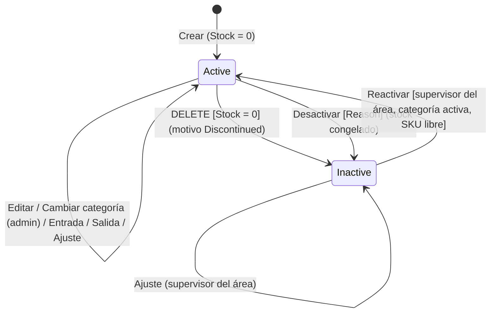
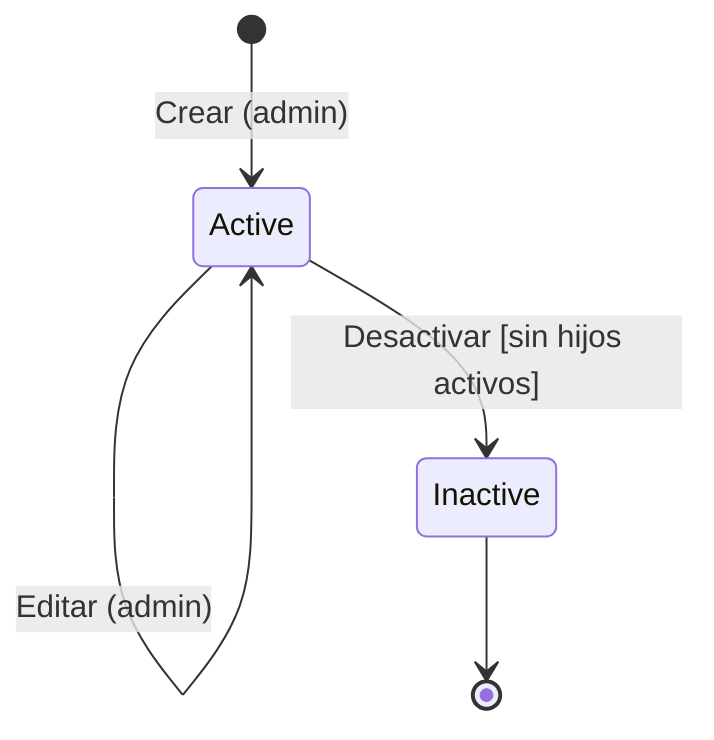
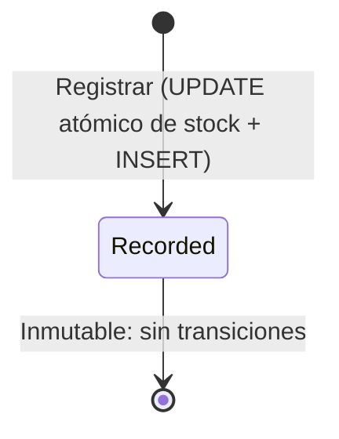

# DOMAIN_LOGIC — Reglas de Negocio

> **Capa 0 SDAP · Inmutable.** Las reglas de este documento son inviolables. Si una tarea requiere una regla no listada, el agente **se detiene y pregunta**.
> Decisiones de origen: ADR-0004 a ADR-0010, ADR-0014.

---

## 1. Lenguaje ubicuo (glosario)

| Término | Código | Definición |
|---|---|---|
| Área | `Area` | Departamento del almacén (Alimentos, Aseo, Herramientas). Unidad de responsabilidad de un supervisor. Se identifica por un `Code` corto. |
| Categoría | `Category` | Clasificación de productos dentro de un área (Lácteos, Granos). Pertenece a una sola área. |
| Producto | `Product` | Artículo inventariable con `Sku` único. Pertenece a una sola categoría. |
| SKU | `Sku` | Código de negocio del producto (etiqueta o código de barras). |
| Stock | `Stock` | Saldo materializado de unidades disponibles. Solo cambia mediante movimientos. |
| Punto de reorden | `MinimumStock` | Umbral por debajo del cual (o igual) el producto se considera con stock bajo. |
| Movimiento | `InventoryMovement` | Registro inmutable de un cambio de stock: entrada, salida o ajuste. |
| Delta | `Delta` | Variación con signo que un movimiento aplica al stock. |
| Desactivación | — | Baja lógica (`IsActive = false`). El registro y su histórico se conservan. |
| Stock congelado | — | Stock de un producto inactivo: no admite entradas ni salidas, solo ajustes. |
| Ajuste compensatorio | — | Ajuste que corrige un movimiento erróneo y lo referencia (`RelatedMovementId`). |

---

## 2. Catálogo de enumeraciones

| Enum | Valores (valor almacenado) |
|---|---|
| `MovementType` | `In` = 1, `Out` = 2, `Adjustment` = 3 |
| `DeactivationReason` | `Expired` = 1, `Damaged` = 2, `Discontinued` = 3, `Recalled` = 4, `Other` = 5 |
| `AdjustmentReason` | `PhysicalCountCorrection` = 1, `Damage` = 2, `Expiration` = 3, `LossOrTheft` = 4, `Found` = 5, `DataEntryError` = 6 |

En la API se serializan como texto (`"In"`, `"Expired"`…). En la BD se almacenan como `TINYINT`.

---

## 3. Reglas de negocio

### 3.1. Áreas (RA)

| Regla | Descripción | Error |
|---|---|---|
| RA-01 | `Code`: 2–10 caracteres, solo letras mayúsculas A–Z. Único entre áreas activas. **Inmutable** tras la creación (lo referencian los grupos de Keycloak). | `VALIDATION_ERROR` / `AREA_CODE_ALREADY_EXISTS` |
| RA-02 | `Name`: obligatorio, 3–100 caracteres. | `VALIDATION_ERROR` |
| RA-03 | No se puede desactivar un área con categorías activas. | `AREA_HAS_ACTIVE_CATEGORIES` |
| RA-04 | No se puede modificar ni desactivar un área inactiva. | `AREA_INACTIVE` |

### 3.2. Categorías (RC)

| Regla | Descripción | Error |
|---|---|---|
| RC-01 | `Name`: obligatorio, 3–100 caracteres, único entre categorías activas. | `VALIDATION_ERROR` / `CATEGORY_NAME_ALREADY_EXISTS` |
| RC-02 | `AreaId` debe referenciar un área existente y activa (al crear o al mover la categoría). | `REFERENCED_AREA_INVALID` |
| RC-03 | No se puede desactivar una categoría con productos activos. | `CATEGORY_HAS_ACTIVE_PRODUCTS` |
| RC-04 | No se puede modificar ni desactivar una categoría inactiva. | `CATEGORY_INACTIVE` |

### 3.3. Productos (RP)

| Regla | Descripción | Error |
|---|---|---|
| RP-01 | `Sku`: obligatorio, 3–50 caracteres, patrón `^[A-Z0-9-]+$`, único entre productos activos. **Inmutable.** | `VALIDATION_ERROR` / `SKU_ALREADY_EXISTS` |
| RP-02 | `Name`: obligatorio, 3–150 caracteres. `Description`: opcional, máximo 1000. | `VALIDATION_ERROR` |
| RP-03 | `CategoryId` debe referenciar una categoría existente y activa. | `REFERENCED_CATEGORY_INVALID` |
| RP-04 | Todo producto nace con `Stock = 0`. El stock **solo** cambia mediante movimientos; ninguna operación de producto lo edita. | — |
| RP-05 | `MinimumStock`: entero ≥ 0, por defecto 0. | `VALIDATION_ERROR` |
| RP-06 | La edición de un producto solo cambia `Name`, `Description` y `MinimumStock`. | — |
| RP-07 | El cambio de categoría es una operación aparte, exclusiva del `admin`. | `FORBIDDEN` / `REFERENCED_CATEGORY_INVALID` |
| RP-08 | `DELETE` solo procede con `Stock = 0`; se registra el motivo `Discontinued` automáticamente. Con stock > 0 se debe usar la desactivación con motivo. | `PRODUCT_HAS_STOCK` |
| RP-09 | La desactivación exige `Reason`. `Notes` (máx. 500) es obligatorio si `Reason = Other`. Se registran `DeactivatedAt` y `DeactivatedBy`. | `VALIDATION_ERROR` |
| RP-10 | Un producto inactivo no admite edición, cambio de categoría, `DELETE` ni nueva desactivación. | `PRODUCT_INACTIVE` |
| RP-11 | La reactivación solo aplica a productos inactivos. | `PRODUCT_ALREADY_ACTIVE` |
| RP-12 | Para reactivar, la categoría del producto debe estar activa y su `Sku` no puede estar en uso por otro producto activo. | `CATEGORY_INACTIVE` / `SKU_ALREADY_EXISTS` |
| RP-13 | La reactivación conserva el stock congelado y registra `ReactivatedAt` y `ReactivatedBy`. Los datos de desactivación previos se mantienen (limitación I-01). | — |
| RP-14 | Un producto tiene stock bajo cuando `Stock <= MinimumStock`. | — |

### 3.4. Movimientos (RM)

| Regla | Descripción | Error |
|---|---|---|
| RM-01 | `In` / `Out`: `Quantity` entero > 0 y ≤ 1.000.000. Se almacena como `Delta` = `+Quantity` / `−Quantity`. | `VALIDATION_ERROR` |
| RM-02 | `Adjustment`: `Delta` entero ≠ 0, con valor absoluto ≤ 1.000.000. | `VALIDATION_ERROR` |
| RM-03 | Ningún movimiento puede dejar el stock negativo. | `INSUFFICIENT_STOCK` |
| RM-04 | `Adjustment` exige `AdjustmentReason`. `In` / `Out` no la admiten. | `VALIDATION_ERROR` |
| RM-05 | Los movimientos son **inmutables**: no existen operaciones de edición ni borrado. | — |
| RM-06 | `RelatedMovementId` (opcional, solo en ajustes) debe existir y pertenecer al mismo producto. | `RELATED_MOVEMENT_INVALID` |
| RM-07 | Cada movimiento guarda `PreviousStock` y `ResultingStock`, con `ResultingStock = PreviousStock + Delta`. | — |
| RM-08 | Producto inactivo: solo admite `Adjustment` (stock congelado). | `PRODUCT_INACTIVE` |
| RM-09 | `CreatedBy` (`sub` del JWT) y `CreatedAt` (UTC) se asignan en el servidor, nunca desde el body. | — |
| RM-10 | `Notes`: opcional, máximo 500 caracteres. | `VALIDATION_ERROR` |
| RM-11 | **Invariante del libro:** para todo producto, `Stock = Σ Delta` de sus movimientos. | — |

### 3.5. Seguridad (RS)

| Regla | Descripción | Error |
|---|---|---|
| RS-01 | Todo endpoint (salvo `/health`) exige un JWT válido emitido por el realm `inventory`, con audiencia `inventory-api`. | `UNAUTHORIZED` |
| RS-02 | Lecturas: scope `inventory.read`. Escrituras: scope `inventory.write`. | `FORBIDDEN` |
| RS-03 | Matriz de roles: ver §4. | `FORBIDDEN` |
| RS-04 | Ajustes y reactivaciones: el usuario debe ser `supervisor` **y** tener en su claim `areas` el `Code` del área a la que pertenece el producto (producto → categoría → área). | `AREA_ACCESS_DENIED` |
| RS-05 | El `admin` no realiza operaciones de stock (movimientos, ajustes, desactivación ni reactivación de productos). Separación de funciones. | `FORBIDDEN` |
| RS-06 | Los datos de auditoría (`CreatedBy`, `DeactivatedBy`, `ReactivatedBy`) salen siempre del token. | — |

---

## 4. Matriz de permisos

| Operación | `operator` | `supervisor` | `admin` |
|---|:-:|:-:|:-:|
| Consultar todo | ✅ | ✅ | ✅ |
| Crear / editar / desactivar áreas y categorías | ❌ | ❌ | ✅ |
| Crear / editar producto | ✅ | ✅ | ❌ |
| Cambiar categoría de producto | ❌ | ❌ | ✅ |
| `DELETE` producto (stock 0) | ✅ | ✅ | ❌ |
| Desactivar producto con motivo | ✅ | ✅ | ❌ |
| Registrar entrada / salida | ✅ | ✅ | ❌ |
| Registrar ajuste | ❌ | ✅ *solo sus áreas* | ❌ |
| Reactivar producto | ❌ | ✅ *solo sus áreas* | ❌ |

---

## 5. Máquinas de estado

### 5.1. Producto

### 5.2. Categoría y Área

La reactivación de áreas y categorías queda fuera de esta versión (mejora I-05).

### 5.3. Movimiento

---

## 6. Catálogo de errores (ProblemDetails)

`title` y `detail` en español; `code` en inglés y estable. Los textos viven en `Application/Common/Messages/ErrorMessages.cs`.

| `code` | HTTP | `title` | `detail` (plantilla) |
|---|---|---|---|
| `VALIDATION_ERROR` | 400 | Datos no válidos | Uno o más campos no son válidos. *(+ `errors` por campo)* |
| `UNAUTHORIZED` | 401 | No autenticado | Debe iniciar sesión para acceder a este recurso. |
| `FORBIDDEN` | 403 | Acceso denegado | No tiene permisos para realizar esta operación. |
| `AREA_ACCESS_DENIED` | 403 | Acceso denegado | No es supervisor del área {areaCode}. |
| `AREA_NOT_FOUND` | 404 | Recurso no encontrado | No existe el área {id}. |
| `CATEGORY_NOT_FOUND` | 404 | Recurso no encontrado | No existe la categoría {id}. |
| `PRODUCT_NOT_FOUND` | 404 | Recurso no encontrado | No existe el producto {id}. |
| `AREA_CODE_ALREADY_EXISTS` | 409 | Conflicto | Ya existe un área activa con el código {code}. |
| `CATEGORY_NAME_ALREADY_EXISTS` | 409 | Conflicto | Ya existe una categoría activa con el nombre {name}. |
| `SKU_ALREADY_EXISTS` | 409 | Conflicto | Ya existe un producto activo con el SKU {sku}. |
| `AREA_HAS_ACTIVE_CATEGORIES` | 409 | Conflicto | El área tiene categorías activas. |
| `CATEGORY_HAS_ACTIVE_PRODUCTS` | 409 | Conflicto | La categoría tiene productos activos. |
| `AREA_INACTIVE` | 409 | Conflicto | El área {id} está inactiva. |
| `CATEGORY_INACTIVE` | 409 | Conflicto | La categoría {id} está inactiva. |
| `PRODUCT_INACTIVE` | 409 | Conflicto | El producto {id} está inactivo. |
| `PRODUCT_ALREADY_ACTIVE` | 409 | Conflicto | El producto {id} ya está activo. |
| `PRODUCT_HAS_STOCK` | 409 | Conflicto | El producto tiene {stock} unidades. Use la desactivación con motivo. |
| `INSUFFICIENT_STOCK` | 409 | Conflicto de inventario | Stock insuficiente: disponible {stock}, solicitado {quantity}. |
| `REFERENCED_AREA_INVALID` | 422 | Referencia no válida | El área {id} no existe o está inactiva. |
| `REFERENCED_CATEGORY_INVALID` | 422 | Referencia no válida | La categoría {id} no existe o está inactiva. |
| `RELATED_MOVEMENT_INVALID` | 422 | Referencia no válida | El movimiento {id} no existe o no pertenece al producto. |
| `INTERNAL_ERROR` | 500 | Error interno | Ocurrió un error inesperado. |

**Criterio de códigos HTTP:** 400 = formato; 404 = el recurso de la URL no existe; 409 = conflicto con el estado actual; 422 = una referencia del body no es válida.
