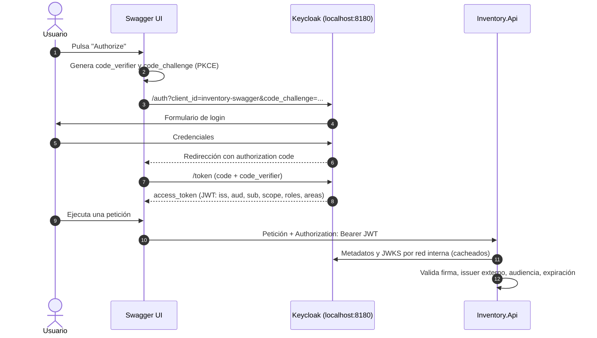
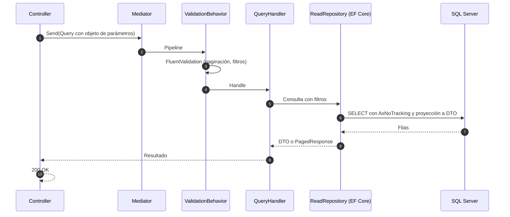
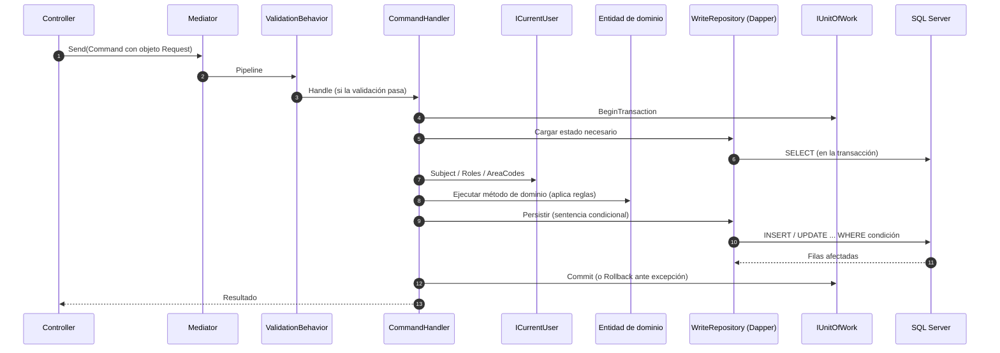
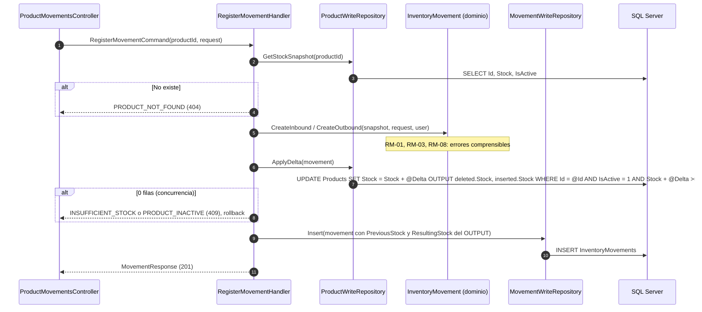
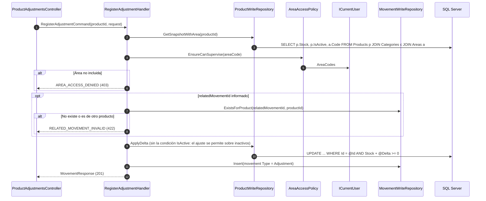
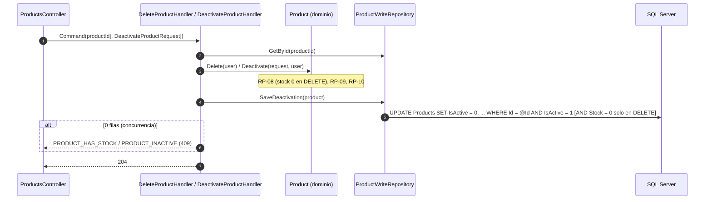
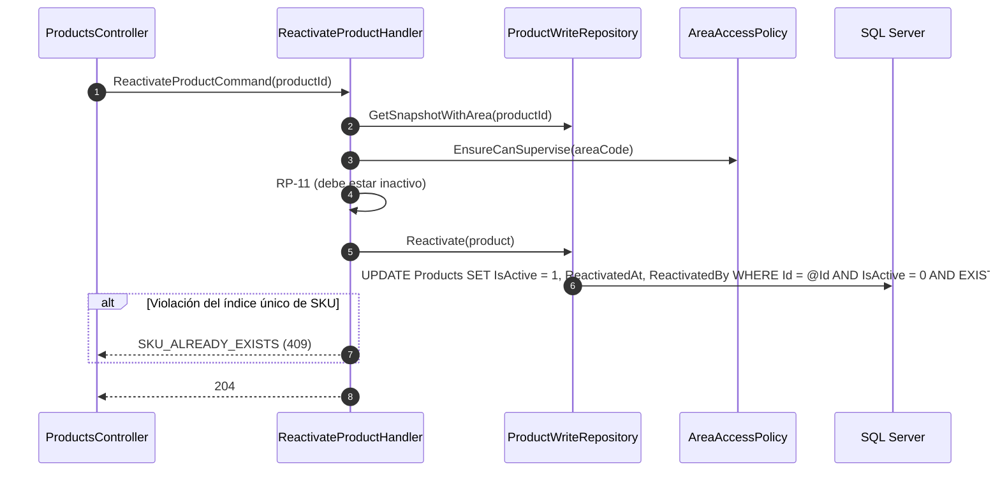
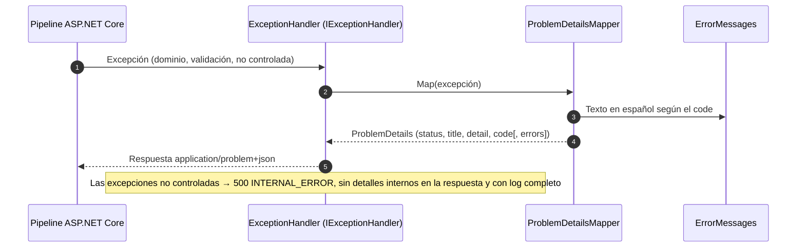
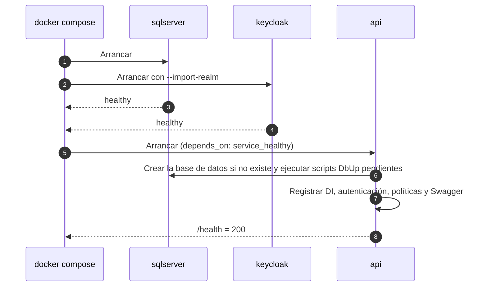

# INTERFACE_FLOW — Flujos Técnicos de Interacción

> **Capa 0 SDAP · Inmutable.** Cada diagrama delimita el orden exacto de llamadas para una tarea atómica. El agente solo puede crear o modificar los componentes que aparecen en el diagrama asignado a su tarea.

---

## SEQ-01 · Autenticación desde Swagger UI (Authorization Code + PKCE)

---

## SEQ-02 · Flujo genérico de Query (lectura con EF Core)

---

## SEQ-03 · Flujo genérico de Command (escritura con Dapper)

---

## SEQ-04 · CU-16 Registrar entrada / salida

> `PreviousStock` y `ResultingStock` se toman del `OUTPUT` del `UPDATE`, no de la lectura previa, para que sean exactos aunque haya concurrencia.

---

## SEQ-05 · CU-17 Registrar ajuste (con alcance por área)

---

## SEQ-06 · CU-12 / CU-13 Baja de producto

---

## SEQ-07 · CU-14 Reactivar producto

---

## SEQ-08 · Manejo de errores

---

## SEQ-09 · Arranque de la aplicación

---

## Casos límite técnicos

| Caso | Tratamiento |
|---|---|
| Dos salidas concurrentes que juntas superan el stock | El `UPDATE ... WHERE Stock + @Delta >= 0` es atómico: una aplica y la otra recibe 0 filas → `INSUFFICIENT_STOCK`. |
| `DELETE` concurrente con una entrada | El `UPDATE ... AND Stock = 0` es atómico: si la entrada llega antes, el `DELETE` falla con `PRODUCT_HAS_STOCK`. |
| Desactivar una categoría mientras se crea un producto en ella | La comprobación del padre en escrituras usa `WITH (UPDLOCK, HOLDLOCK)` dentro de la transacción. |
| Dos creaciones con el mismo SKU, nombre o código simultáneas | El índice único filtrado rechaza la segunda. La violación (error SQL 2601/2627) se traduce a `*_ALREADY_EXISTS` (409). |
| Issuer distinto entre la red Docker y el navegador | `AUTH_METADATA_ADDRESS` (interno) para descargar metadatos y `AUTH_AUTHORITY` (externo) como `ValidIssuer`. |
| Keycloak tarda en arrancar | `depends_on: condition: service_healthy`. |
| Token sin claim `areas` | Se trata como lista vacía: cualquier operación con alcance por área → `AREA_ACCESS_DENIED`. |
| `page` más allá del total | `200` con `items: []`. |

---

## Delimitación de alcance por módulo

| Módulo | Diagramas | Puede tocar | Prohibido tocar |
|---|---|---|---|
| Areas | SEQ-02, SEQ-03 | `*/Areas/*`, `AreasController`, scripts de `Areas` | Otros módulos, `Common` sin autorización |
| Categories | SEQ-02, SEQ-03 | `*/Categories/*`, `CategoriesController` | Lógica de `Areas` (solo consulta su estado) |
| Products | SEQ-02, SEQ-03, SEQ-06, SEQ-07 | `*/Products/*`, `ProductsController` | Tabla `InventoryMovements`; edición directa de `Stock` |
| Movements | SEQ-04, SEQ-05 | `*/Movements/*`, `ProductMovementsController`, `ProductAdjustmentsController`, `ProductWriteRepository.ApplyDelta` | Cualquier `UPDATE` o `DELETE` sobre `InventoryMovements` |
| Seguridad | SEQ-01, SEQ-05 | `Api/Authorization/*`, `AreaAccessPolicy`, `ICurrentUser`, `keycloak/realm-inventory.json` | Lógica de negocio de los módulos |
| Errores | SEQ-08 | `Api/ErrorHandling/*`, `ErrorMessages` | Mensajes fuera de `ErrorMessages` |
| Infraestructura base | SEQ-09 | `docker-compose.yml`, `Dockerfile`, `Program.cs`, scripts DbUp | Scripts DbUp ya commiteados (se añade uno nuevo, nunca se edita) |
