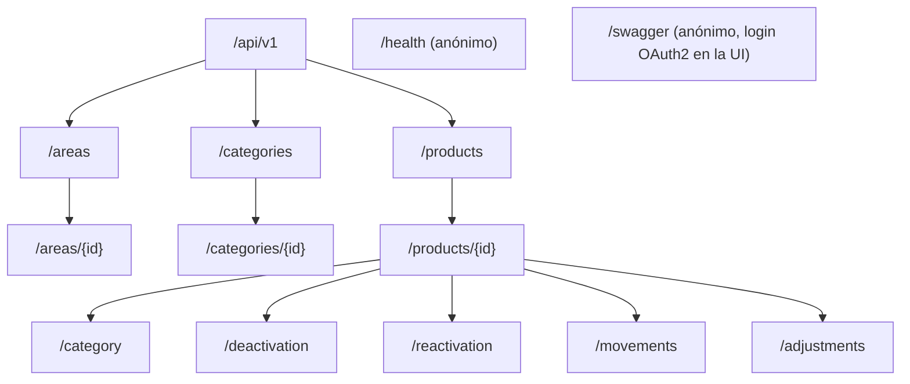

# SCREEN_FLOW — Superficie de la API (adaptación SDAP para backend)

> **Capa 0 SDAP · Inmutable.**
> **Adaptación justificada:** el sistema no tiene interfaz propia (el único cliente visual es Swagger UI). En SDAP, `SCREEN_FLOW` es el contrato del *router* y de los estados visibles para el cliente. En un backend, ese contrato es la **superficie HTTP**: rutas declarativas, políticas de acceso, DTOs y la matriz de estados de respuesta. Ningún agente puede crear rutas que no estén en este documento.

---

## 1. Grafo de navegación de recursos

---

## 2. Políticas de autorización

| Política | Requisitos | Comprobación adicional en `Application` |
|---|---|---|
| `CanRead` | scope `inventory.read` | — |
| `CanOperate` | scope `inventory.write` + rol `operator` o `supervisor` | — |
| `CanSupervise` | scope `inventory.write` + rol `supervisor` | Alcance por área (RS-04) |
| `CanAdminister` | scope `inventory.write` + rol `admin` | — |

---

## 3. Tabla maestra de rutas (contrato del router)

| # | Método | Ruta | CU | Política | Request | Respuesta OK | Errores de negocio |
|---|---|---|---|---|---|---|---|
| E01 | GET | `/api/v1/areas` | CU-04 | CanRead | `AreaQueryParameters` | 200 `PagedResponse<AreaResponse>` | 400 |
| E02 | GET | `/api/v1/areas/{id}` | CU-04 | CanRead | — | 200 `AreaResponse` | 404 |
| E03 | POST | `/api/v1/areas` | CU-01 | CanAdminister | `CreateAreaRequest` | 201 `AreaResponse` + `Location` | 400, 409 |
| E04 | PUT | `/api/v1/areas/{id}` | CU-02 | CanAdminister | `UpdateAreaRequest` | 204 | 400, 404, 409 |
| E05 | DELETE | `/api/v1/areas/{id}` | CU-03 | CanAdminister | — | 204 | 404, 409 |
| E06 | GET | `/api/v1/categories` | CU-08 | CanRead | `CategoryQueryParameters` | 200 `PagedResponse<CategoryResponse>` | 400 |
| E07 | GET | `/api/v1/categories/{id}` | CU-08 | CanRead | — | 200 `CategoryResponse` | 404 |
| E08 | POST | `/api/v1/categories` | CU-05 | CanAdminister | `CreateCategoryRequest` | 201 `CategoryResponse` + `Location` | 400, 409, 422 |
| E09 | PUT | `/api/v1/categories/{id}` | CU-06 | CanAdminister | `UpdateCategoryRequest` | 204 | 400, 404, 409, 422 |
| E10 | DELETE | `/api/v1/categories/{id}` | CU-07 | CanAdminister | — | 204 | 404, 409 |
| E11 | GET | `/api/v1/products` | CU-15 | CanRead | `ProductQueryParameters` | 200 `PagedResponse<ProductResponse>` | 400 |
| E12 | GET | `/api/v1/products/{id}` | CU-15 | CanRead | — | 200 `ProductResponse` | 404 |
| E13 | POST | `/api/v1/products` | CU-09 | CanOperate | `CreateProductRequest` | 201 `ProductResponse` + `Location` | 400, 409, 422 |
| E14 | PUT | `/api/v1/products/{id}` | CU-10 | CanOperate | `UpdateProductRequest` | 204 | 400, 404, 409 |
| E15 | PUT | `/api/v1/products/{id}/category` | CU-11 | CanAdminister | `ChangeProductCategoryRequest` | 204 | 400, 404, 409, 422 |
| E16 | DELETE | `/api/v1/products/{id}` | CU-12 | CanOperate | — | 204 | 404, 409 |
| E17 | POST | `/api/v1/products/{id}/deactivation` | CU-13 | CanOperate | `DeactivateProductRequest` | 204 | 400, 404, 409 |
| E18 | POST | `/api/v1/products/{id}/reactivation` | CU-14 | CanSupervise | — | 204 | 403, 404, 409 |
| E19 | POST | `/api/v1/products/{id}/movements` | CU-16 | CanOperate | `RegisterMovementRequest` | 201 `MovementResponse` | 400, 404, 409 |
| E20 | POST | `/api/v1/products/{id}/adjustments` | CU-17 | CanSupervise | `RegisterAdjustmentRequest` | 201 `MovementResponse` | 400, 403, 404, 409, 422 |
| E21 | GET | `/api/v1/products/{id}/movements` | CU-18 | CanRead | `MovementQueryParameters` | 200 `PagedResponse<MovementResponse>` | 400, 404 |
| E22 | GET | `/health` | — | Anónimo | — | 200 | — |

Todas las rutas protegidas responden además `401` (sin token o token inválido) y `403` (scope o rol insuficiente).

---

## 4. Matriz canónica de estados de respuesta

Equivalente backend de los estados de pantalla `Loading / Data / Empty / Error`:

| Estado SDAP | Equivalente HTTP | Forma de la respuesta |
|---|---|---|
| Loading | — (no aplica en el servidor) | — |
| Data / Idle | `200` / `201` / `204` | DTO, `PagedResponse<T>` o sin cuerpo |
| Empty | `200` con `items: []` y `totalCount: 0` | **Nunca** `404` para un listado vacío |
| Error / Retry | `4xx` (error del cliente, no reintentar sin cambiar la petición) / `5xx` (reintentable) | `ProblemDetails` con `code` (DOMAIN_LOGIC §6) |

---

## 5. Trazabilidad Ruta ↔ Caso de Uso ↔ DTO ↔ Reglas

| Ruta | CU | DTO | Reglas |
|---|---|---|---|
| E03–E05 | CU-01–03 | `CreateAreaRequest`, `UpdateAreaRequest` | RA-01–RA-04 |
| E08–E10 | CU-05–07 | `CreateCategoryRequest`, `UpdateCategoryRequest` | RC-01–RC-04 |
| E13–E14 | CU-09–10 | `CreateProductRequest`, `UpdateProductRequest` | RP-01–RP-06, RP-10 |
| E15 | CU-11 | `ChangeProductCategoryRequest` | RP-03, RP-07, RP-10 |
| E16–E17 | CU-12–13 | `DeactivateProductRequest` | RP-08–RP-10 |
| E18 | CU-14 | — | RP-11–RP-13, RS-04 |
| E19 | CU-16 | `RegisterMovementRequest` | RM-01, RM-03, RM-05, RM-07–RM-10 |
| E20 | CU-17 | `RegisterAdjustmentRequest` | RM-02–RM-10, RS-04 |
| E11–E12, E21 | CU-15, CU-18 | `ProductQueryParameters`, `MovementQueryParameters` | RP-14 |

---

## 6. Convenciones de la superficie
- Prefijo de versión `/api/v1`.
- Rutas en minúsculas y en plural.
- Las acciones de dominio que no encajan en CRUD son **sub-recursos con POST** (`/deactivation`, `/reactivation`, `/adjustments`).
- `POST` de creación devuelve `201` + cabecera `Location` + cuerpo. `PUT` y `DELETE` devuelven `204`.
- Swagger documenta cada endpoint con todos sus códigos de respuesta y ejemplos de `ProblemDetails`.
