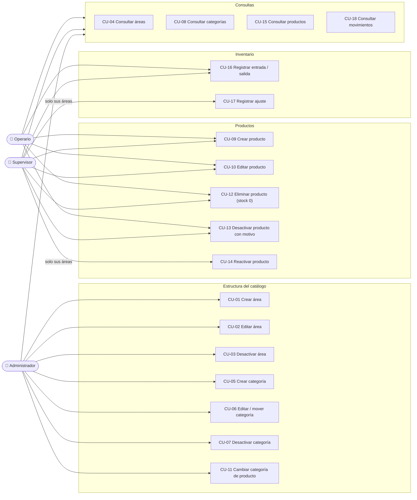

# USE_CASES — Casos de Uso y Actores

> **Capa 0 SDAP · Inmutable.** Un agente no puede inventar validaciones, permisos ni excepciones fuera de lo descrito aquí y en `DOMAIN_LOGIC.md`.
> Todos los casos de uso exigen un usuario autenticado (RS-01). Los errores 401/403 por rol o scope no se repiten en cada caso.

---

## 1. Actores

| Actor | Tipo | Descripción |
|---|---|---|
| Operario (`operator`) | Humano | Mantiene productos y registra entradas y salidas. Alcance global. |
| Supervisor (`supervisor`) | Humano | Lo mismo que el operario, más ajustes y reactivaciones **en sus áreas**. |
| Administrador (`admin`) | Humano | Gestiona la estructura del catálogo (áreas, categorías, categoría de un producto). No toca el stock. |
| Keycloak | Sistema | Autentica usuarios y emite tokens con roles, scopes y áreas. |

---

## 2. Diagrama de actores y casos de uso

---

## 3. Catálogo

| CU | Nombre | Actor | Endpoint |
|---|---|---|---|
| CU-01 | Crear área | admin | `POST /api/v1/areas` |
| CU-02 | Editar área | admin | `PUT /api/v1/areas/{id}` |
| CU-03 | Desactivar área | admin | `DELETE /api/v1/areas/{id}` |
| CU-04 | Consultar áreas | todos | `GET /api/v1/areas`, `GET /api/v1/areas/{id}` |
| CU-05 | Crear categoría | admin | `POST /api/v1/categories` |
| CU-06 | Editar / mover categoría | admin | `PUT /api/v1/categories/{id}` |
| CU-07 | Desactivar categoría | admin | `DELETE /api/v1/categories/{id}` |
| CU-08 | Consultar categorías | todos | `GET /api/v1/categories`, `GET /api/v1/categories/{id}` |
| CU-09 | Crear producto | operator, supervisor | `POST /api/v1/products` |
| CU-10 | Editar producto | operator, supervisor | `PUT /api/v1/products/{id}` |
| CU-11 | Cambiar categoría de producto | admin | `PUT /api/v1/products/{id}/category` |
| CU-12 | Eliminar producto (stock 0) | operator, supervisor | `DELETE /api/v1/products/{id}` |
| CU-13 | Desactivar producto con motivo | operator, supervisor | `POST /api/v1/products/{id}/deactivation` |
| CU-14 | Reactivar producto | supervisor del área | `POST /api/v1/products/{id}/reactivation` |
| CU-15 | Consultar productos | todos | `GET /api/v1/products`, `GET /api/v1/products/{id}` |
| CU-16 | Registrar entrada / salida | operator, supervisor | `POST /api/v1/products/{id}/movements` |
| CU-17 | Registrar ajuste | supervisor del área | `POST /api/v1/products/{id}/adjustments` |
| CU-18 | Consultar movimientos | todos | `GET /api/v1/products/{id}/movements` |

---

## 4. Especificación de casos de uso

### CU-01 · Crear área
- **Precondiciones:** rol `admin`.
- **Entrada:** `CreateAreaRequest`.
- **Flujo principal:**
  1. Validar formato (RA-01, RA-02).
  2. Verificar que el `Code` no esté en uso por un área activa.
  3. Insertar.
  4. Responder `201` + `Location` + `AreaResponse`.
- **Excepciones:** formato → `VALIDATION_ERROR`; código duplicado → `AREA_CODE_ALREADY_EXISTS`.
- **Postcondición:** área activa. Para asignarle supervisores hay que crear el grupo `/areas/{Code}` en Keycloak (operación fuera de la API).

### CU-02 · Editar área
- **Precondiciones:** rol `admin`; área existente y activa.
- **Entrada:** `UpdateAreaRequest` (solo `name`; el `Code` es inmutable).
- **Flujo principal:** validar → actualizar `Name` y `UpdatedAt` → `204`.
- **Excepciones:** `AREA_NOT_FOUND`, `AREA_INACTIVE`, `VALIDATION_ERROR`.

### CU-03 · Desactivar área
- **Precondiciones:** rol `admin`.
- **Flujo principal:**
  1. Verificar que el área existe y está activa.
  2. Verificar que no tiene categorías activas (RA-03).
  3. `IsActive = 0`.
  4. Responder `204`.
- **Excepciones:** `AREA_NOT_FOUND`, `AREA_INACTIVE`, `AREA_HAS_ACTIVE_CATEGORIES`.

### CU-04 · Consultar áreas
- **Flujo principal:** listado paginado con filtro `status`, o detalle por `id` (devuelve también las inactivas).
- **Excepciones:** `AREA_NOT_FOUND` (detalle).

### CU-05 · Crear categoría
- **Precondiciones:** rol `admin`.
- **Entrada:** `CreateCategoryRequest`.
- **Flujo principal:** validar (RC-01) → verificar área activa (RC-02) → verificar nombre libre → insertar → `201`.
- **Excepciones:** `VALIDATION_ERROR`, `REFERENCED_AREA_INVALID`, `CATEGORY_NAME_ALREADY_EXISTS`.

### CU-06 · Editar / mover categoría
- **Precondiciones:** rol `admin`; categoría existente y activa.
- **Entrada:** `UpdateCategoryRequest`.
- **Flujo principal:** validar → si cambia `areaId`, verificar el área destino (RC-02) → si cambia `name`, verificar unicidad → actualizar → `204`.
- **Excepciones:** `CATEGORY_NOT_FOUND`, `CATEGORY_INACTIVE`, `REFERENCED_AREA_INVALID`, `CATEGORY_NAME_ALREADY_EXISTS`.
- **Nota:** mover una categoría cambia qué supervisores pueden ajustar sus productos. Por eso es exclusivo del `admin`.

### CU-07 · Desactivar categoría
- **Precondiciones:** rol `admin`.
- **Flujo principal:** verificar que existe y está activa → sin productos activos (RC-03) → `IsActive = 0` → `204`.
- **Excepciones:** `CATEGORY_NOT_FOUND`, `CATEGORY_INACTIVE`, `CATEGORY_HAS_ACTIVE_PRODUCTS`.

### CU-08 · Consultar categorías
- **Flujo principal:** listado paginado con filtros `areaId` y `status`, o detalle por `id`.
- **Excepciones:** `CATEGORY_NOT_FOUND` (detalle).

### CU-09 · Crear producto
- **Precondiciones:** rol `operator` o `supervisor`.
- **Entrada:** `CreateProductRequest`.
- **Flujo principal:**
  1. Validar (RP-01, RP-02, RP-05).
  2. Verificar categoría activa (RP-03).
  3. Verificar SKU libre.
  4. Insertar con `Stock = 0` (RP-04).
  5. Responder `201` + `ProductResponse`.
- **Excepciones:** `VALIDATION_ERROR`, `REFERENCED_CATEGORY_INVALID`, `SKU_ALREADY_EXISTS`.

### CU-10 · Editar producto
- **Precondiciones:** rol `operator` o `supervisor`; producto activo.
- **Entrada:** `UpdateProductRequest`.
- **Flujo principal:** validar → actualizar `Name`, `Description`, `MinimumStock` (RP-06) → `204`.
- **Excepciones:** `PRODUCT_NOT_FOUND`, `PRODUCT_INACTIVE`, `VALIDATION_ERROR`.

### CU-11 · Cambiar categoría de producto
- **Precondiciones:** rol `admin`; producto activo.
- **Entrada:** `ChangeProductCategoryRequest`.
- **Flujo principal:** verificar categoría destino activa → actualizar `CategoryId` → `204`.
- **Excepciones:** `PRODUCT_NOT_FOUND`, `PRODUCT_INACTIVE`, `REFERENCED_CATEGORY_INVALID`.

### CU-12 · Eliminar producto (stock 0)
- **Precondiciones:** rol `operator` o `supervisor`; producto activo.
- **Flujo principal:**
  1. Verificar que el producto existe.
  2. Verificar `Stock = 0` (RP-08).
  3. Desactivar con motivo `Discontinued`, `DeactivatedAt` y `DeactivatedBy`.
  4. Responder `204`.
- **Flujo alterno:** con `Stock > 0` → `409 PRODUCT_HAS_STOCK`, que indica usar CU-13.
- **Excepciones:** `PRODUCT_NOT_FOUND`, `PRODUCT_INACTIVE`, `PRODUCT_HAS_STOCK`.

### CU-13 · Desactivar producto con motivo
- **Precondiciones:** rol `operator` o `supervisor`; producto activo.
- **Entrada:** `DeactivateProductRequest`.
- **Flujo principal:** validar (RP-09) → desactivar registrando motivo, notas, fecha y usuario → `204`. El stock queda congelado.
- **Excepciones:** `PRODUCT_NOT_FOUND`, `PRODUCT_INACTIVE`, `VALIDATION_ERROR`.

### CU-14 · Reactivar producto
- **Precondiciones:** rol `supervisor` con el área del producto en su claim `areas` (RS-04).
- **Flujo principal:**
  1. Cargar el producto con su área.
  2. Verificar el alcance por área.
  3. Verificar que está inactivo (RP-11).
  4. Verificar categoría activa y SKU libre (RP-12).
  5. Reactivar registrando fecha y usuario (RP-13).
  6. Responder `204`.
- **Excepciones:** `PRODUCT_NOT_FOUND`, `AREA_ACCESS_DENIED`, `PRODUCT_ALREADY_ACTIVE`, `CATEGORY_INACTIVE`, `SKU_ALREADY_EXISTS`.

### CU-15 · Consultar productos
- **Flujo principal:** listado paginado con filtros `categoryId`, `status`, `search`, `lowStock` y orden; o detalle por `id` (incluye inactivos con sus datos de desactivación).
- **Excepciones:** `PRODUCT_NOT_FOUND` (detalle), `VALIDATION_ERROR` (parámetros fuera de rango o `sortBy` no permitido).

### CU-16 · Registrar entrada / salida
- **Precondiciones:** rol `operator` o `supervisor`; producto activo (RM-08).
- **Entrada:** `RegisterMovementRequest`.
- **Flujo principal:**
  1. Validar (RM-01, RM-10).
  2. Cargar el producto.
  3. Construir el movimiento en el dominio.
  4. En una transacción: `UPDATE` atómico del stock con la condición `Stock + Delta >= 0 AND IsActive = 1`, más `INSERT` del movimiento con el stock previo y el resultante.
  5. Responder `201` + `MovementResponse`.
- **Excepciones:** `PRODUCT_NOT_FOUND`, `PRODUCT_INACTIVE`, `INSUFFICIENT_STOCK` (RM-03), `VALIDATION_ERROR`.

### CU-17 · Registrar ajuste
- **Precondiciones:** rol `supervisor` con el área del producto en su claim (RS-04). Se permite sobre productos inactivos (RM-08).
- **Entrada:** `RegisterAdjustmentRequest`.
- **Flujo principal:**
  1. Validar (RM-02, RM-04, RM-10).
  2. Cargar el producto con su área.
  3. Verificar el alcance por área.
  4. Si hay `relatedMovementId`, verificar que pertenece al producto (RM-06).
  5. Transacción con `UPDATE` atómico (`Stock + Delta >= 0`) e `INSERT`.
  6. Responder `201`.
- **Excepciones:** `PRODUCT_NOT_FOUND`, `AREA_ACCESS_DENIED`, `RELATED_MOVEMENT_INVALID`, `INSUFFICIENT_STOCK`, `VALIDATION_ERROR`.

### CU-18 · Consultar movimientos
- **Flujo principal:** verificar que el producto existe (activo o no) → listado paginado con filtros `type`, `from`, `to`, ordenado por `createdAt desc`.
- **Excepciones:** `PRODUCT_NOT_FOUND`, `VALIDATION_ERROR` (`from > to`).
